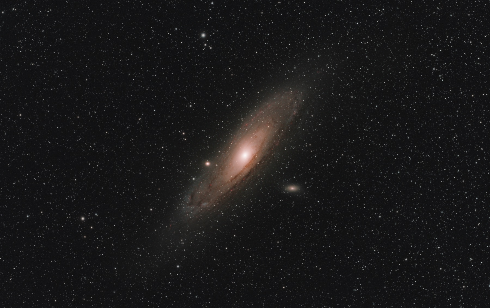

<p align="center">
  
</p>

<h1 align="center">Kappa-Sigma</h1>

<p align="center">
  <strong>L'astrophotographie du ciel profond sur Mac, de la nuit brute à l'image finie.</strong><br>
  Empilez vos captures avec Siril, puis finissez-les dans un Studio aux aperçus Metal en temps réel :
  chaque réglage visible, expliqué, et à vous.
</p>

<p align="center">
  <a href="#démarrage-rapide">Démarrage rapide</a> &middot;
  <a href="#comment-ça-marche">Comment ça marche</a> &middot;
  <a href="#technologies">Technologies</a> &middot;
  <a href="#documentation">Documentation</a><br>
  <a href="README.md">English</a> &middot; Français
</p>

<p align="center">
  
  
  
  
</p>

<p align="center">
  
  <br>
  <sub>M 31, la galaxie d'Andromède, avec ses compagnes M 32 et M 110.</sub>
</p>

<p align="center">
  
  <br>
  <sub>NGC 7000, la nébuleuse North America, avec la nébuleuse du Pélican, IC 5070.</sub>
</p>

---

Une nuit de ciel profond laisse des centaines de brutes, de darks, de flats et d'offsets. En tirer
une image, c'est calibrer, écarter les mauvaises poses, aligner, empiler, puis étirer et colorer un
signal qui n'est presque que du bruit. Les outils existants cachent leurs décisions ou les noient
dans des centaines de panneaux.

**Kappa-Sigma** est une app macOS native qui mène une cible du dossier de capture à l'image finie :

- **Reproductible.** Siril fait les calculs sur les pixels : mêmes poses et mêmes réglages, même
  empilement, à l'octet près.
- **Rien de caché.** Chaque verdict (une pose rejetée, un master choisi, une pose de référence) est
  montré et peut être renversé.
- **La valeur affichée est la valeur appliquée.** Aucun traitement ne mesure l'image pour changer
  ses propres réglages en douce ; une mesure ne remplit jamais qu'une suggestion.
- **Vos données restent à vous.** Captures, masters et résultats antérieurs sont en lecture seule ;
  l'app n'écrit que dans ses projets.

## Démarrage rapide

**Prérequis :** un Mac sous macOS 26 avec les Command Line Tools (Swift 6.2 ou plus récent) et
[`just`](https://github.com/casey/just). Xcode n'est pas requis.

| Outil hôte | Sert à |
|------------|--------|
| [Siril](https://siril.org) 1.4 | Empilement, résolution astrométrique, calibration des couleurs (requis) |
| [GraXpert](https://graxpert.com) | Extraction de fond (facultatif, Siril sait aussi le faire) |
| [StarNet2](https://www.starnetastro.com) | Séparation des étoiles à l'export (facultatif) |

Un outil absent grise les traitements qui en ont besoin, avec une fiche d'installation ; rien ne
bascule en silence sur un autre algorithme.

```bash
git clone https://github.com/verovec/kappa-sigma.git && cd kappa-sigma
just setup                              # installe swiftlint et le hook pre-push, vérifie l'hôte
just app-build -c release               # construit AstroStack.app optimisée
open -n apps/macos/.build/AstroStack.app
```

Utilisez le build release pour les vraies nuits : empilement et aperçus sont bien plus rapides.
Pour développer, `just app-run` construit un bundle debug au même chemin et l'ouvre (il remplace
le release, et inversement). `just doctor` fait le point sur la chaîne d'outils, les outils hôtes
et les dossiers de données depuis le terminal.

## Comment ça marche

Un projet est un paquet `.astrostack` (une base SQLite et ses images) pour une cible.
**Nouveau projet…** le crée, **Importer des captures…** lit votre dossier de capture (sans jamais y
écrire), puis la barre latérale vous mène à travers six étapes, dans l'ordre où travaille un
astrophotographe. Chaque étape montre son état (à faire, prête, à regarder, faite) et vous passez
librement de l'une à l'autre : rien n'avance tout seul.

| Étape | Ce que vous y faites |
|-------|----------------------|
| **Données** | Voir vos poses classées par nuit, filtre et type, avec le temps d'intégration et la couverture de calibration ; ajouter une nuit plus tard et relire ; élaguer ou supprimer les empilements jamais exportés. |
| **Calibration** | Associer chaque série aux masters de votre bibliothèque, nuit par nuit, chaque choix modifiable ; inspecter les statistiques d'un master et le reconstruire. |
| **Tri** | Noter chaque pose, les faire défiler en blink, garder ou rejeter, épingler la référence d'alignement ; double-cliquer une pose pour l'ouvrir dans la visionneuse. |
| **Empilement** | Empiler une ou plusieurs nuits par Siril, voies large bande et dual-band côte à côte, avec des réglages simples ou avancés par voie. Suivre le journal, mettre en pause, reprendre après réouverture, annuler ; l'espace de travail est vérifié avant le run et nettoyé après. |
| **Studio** | Finir l'image avec des aperçus GPU en direct : étirement (MTF, GHS, arcsinh), niveaux, courbes, saturation, désaturation du ciel, balance des couleurs, écrans d'émission, injection de raies Hα / OIII, HDR, débruitage, recadrage, rotation et miroir. Extraction de fond (GraXpert ou Siril), résolution astrométrique et calibration des couleurs (PCC ou SPCC). Travailler sur l'image combinée ou la branche de chaque canal, avec des masques, un historique annulable par couche, des profils, et des pipelines qui se rejouent sur un nouvel empilement. |
| **Export** | Séparer les étoiles avec StarNet2 et écrire les livrables, avec la recette qui les a produits. |

Partout dans l'app :

- **Visionneuse :** FITS sur le GPU avec zoom, déplacement et plein écran, étirement d'affichage
  automatique ou manuel, histogramme qui nomme l'image qu'il compte, lecture des pixels avec
  AD/Déc, surexpositions en surimpression et comparaison avant/après.
- **Objets du ciel :** un catalogue tiré des listes de Siril, cherchable par n'importe quel alias et
  proposé à la résolution astrométrique.
- **Aide :** une fiche pour chaque étape, traitement et réglage, qui explique chaque valeur par
  défaut.
- **Clavier :** plein écran (⇧⌘F), zoom (⌘= / ⌘-), rotation et miroir, le panneau Présentation
  (⌥⌘0), et un seul ⌘Z annule tout un run de pipeline.
- **Langues :** anglais et français.

## Technologies

| Couche | Technologie | Emplacement |
|--------|-------------|-------------|
| Interface | SwiftUI et AppKit (app à documents) | `apps/macos/Sources/AstroStackApp` |
| Aperçus en temps réel | Noyaux Metal 3, chacun vérifié face à un oracle CPU | `RenderKit`, `ProcessKit` |
| Calcul d'image | Accelerate (vDSP, vImage), float32 planaire | `ImageKit`, `StackKit` |
| Prétraitement | Siril 1.4 piloté par tubes nommés | `StackKit` |
| Stockage des projets | SQLite via GRDB, migrations SQL versionnées | `ProjectKit` |
| Tests | Swift Testing, oracles enregistrés, suites live sur de vraies captures | `apps/macos/Tests` |

Swift 6 uniquement : pas de serveur, pas de binaire auxiliaire, pas de second langage. Détails dans
[Architecture](docs/architecture.md).

## Documentation

| Sujet | Où |
|-------|-----|
| Modules, outils hôtes, emplacement de vos données | [`docs/architecture.md`](docs/architecture.md) |
| Chaîne d'outils, recettes, tests, CI, conventions | [`docs/development.md`](docs/development.md) |
| Conception du produit et de l'architecture | [`docs/design/astrostack-macos.md`](docs/design/astrostack-macos.md) |
| Portes qualité et décisions du portage Swift | [`docs/engineering/swift-quality-playbook.md`](docs/engineering/swift-quality-playbook.md) |
| Tout le reste | [`docs/`](docs/README.md) |

La documentation détaillée est en anglais.

## Contribuer

Les tickets et les pull requests sont bienvenus. Lancez `just check` avant de pousser : c'est la
même porte que la CI (hygiène, lint, build de l'app, suite de tests complète). Les conventions de
la maison sont dans [`conventions/`](conventions/), et
[`docs/development.md`](docs/development.md) explique les tests, les oracles et les suites live.

## Licence

[MIT](LICENSE) © 2026 Clément Verove
