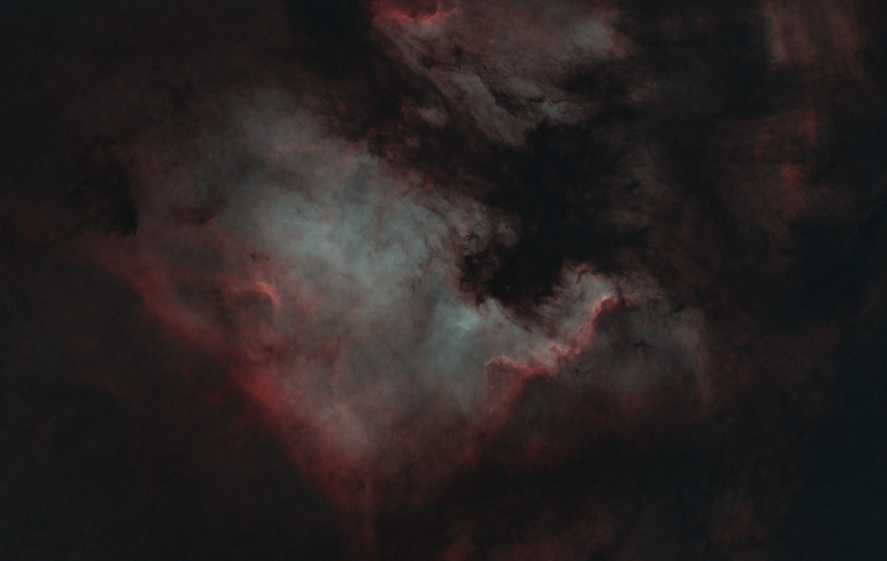

<p align="center">
  
</p>

<h1 align="center">Kappa-Sigma</h1>

<p align="center">
  <strong>Deep-sky astrophotography on the Mac, from the raw night to the finished image.</strong><br>
  Stack your captures with Siril, then finish them in a Studio with real-time Metal previews:
  every setting visible, explained and yours.
</p>

<p align="center">
  <a href="#quick-start">Quick start</a> &middot;
  <a href="#how-it-works">How it works</a> &middot;
  <a href="#status">Status</a> &middot;
  <a href="#tech-stack">Tech stack</a> &middot;
  <a href="#documentation">Documentation</a><br>
  English &middot; <a href="README.fr.md">Français</a>
</p>

<p align="center">
  
  
  
  
</p>

<p align="center">
  
  <br>
  <sub>NGC 7000, the North America Nebula: Hα and OIII over RGB, captured and stacked by the author
  with the pipeline Kappa-Sigma replaces.</sub>
</p>

---

A night of deep-sky imaging leaves hundreds of raw frames, darks, flats and offsets. Turning them
into an image means calibrating, rejecting the bad frames, aligning, stacking, then stretching and
colouring a signal that is almost all noise. Existing tools either hide their decisions or bury
them in hundreds of panels.

**Kappa-Sigma** is a native macOS app that walks one target through that journey, from the capture
folder to the deliverable. Siril does the pixel math, so a stack is reproducible to the byte. Every
verdict the app reaches (a rejected frame, a chosen master, a reference frame) is shown and can be
overruled, and no process quietly changes its own settings: the value you see is the value applied.

The name comes from kappa-sigma clipping, the outlier rejection at the heart of every image stack.

## Quick start

**Prerequisites:** a Mac on macOS 26 with the Command Line Tools (Swift 6.2 or later) and
[`just`](https://github.com/casey/just). Siril 1.4 is needed to stack; GraXpert and StarNet2 are
optional. Xcode is not required.

```bash
git clone https://github.com/verovec/kappa-sigma.git && cd kappa-sigma
just setup      # install swiftlint and the pre-push hook, then check the host
just app-run    # build AstroStack.app (debug) and open it
just app-run-release   # optimized build for real runs (same bundle path, replaces the debug one)
```

The welcome window lists your recent projects and which host tools are found (`just doctor` says
the same from the terminal). **New Project…** creates a project for a target; **Import Captures…**
reads a capture folder (it is never written) and shows how each night will be calibrated; then
follow the stages down the sidebar, from the stack to the Studio and the export.

## How it works

A project is a `.astrostack` package (a SQLite database plus its images). Its window follows the
order an astrophotographer works in:

```
  Données       capture nights, lights per filter, calibration coverage
     |
  Calibration   the masters each light set uses, their statistics, the gaps
     |
  Tri           per-frame metrics, blink, keep or reject, reference frame
     |
  Empilement    the stacking settings and the Siril run, with its journal
     |
  Studio        stretch, emission lines, HDR, colour, star layer, previewed live on the GPU
     |
  Export        the deliverables
```

Every stage shows its state (to do, ready, needs a look, done) and you move between them freely:
nothing jumps ahead on its own. Captures, masters and earlier results stay where they are, read
only; the app writes only inside its projects.

## Status

Kappa-Sigma stacks and finishes a target from end to end; it is validated on the author's M 31
(broadband and dual-band nights) and IC 1848 captures against the legacy pipeline. What works
today:

- Projects: the welcome window (recent projects, host tools), create, save, reopen, and the
  journey sidebar with each stage's state.
- Données and Calibration: a capture folder classified by night, filter and frame type; the
  calibration plan against your master library, every verdict overridable; master inspection and
  rebuild.
- Tri: per-frame metrics, blink, keep or reject at a breakpoint after grading, and a pinned
  registration reference.
- Empilement: single-night and multi-night preprocessing through Siril, broadband and dual-band
  lanes, simple and advanced settings over the preset; progress, journal, pause and continue,
  cancel; the scratch space a run needs is checked before it starts, and what a dead run leaves
  is reaped.
- Studio: live GPU previews of stretch (MTF, GHS, arcsinh), histogram transformation, curves,
  saturation, sky desaturation, colour balance, emission screens, HDR, denoise and geometry;
  background extraction (GraXpert or Siril), plate solving and colour calibration (PCC, SPCC)
  through the host tools; a history with undo, pipelines with breakpoints, and profiles.
- Export: star separation with StarNet2 and the deliverable set.
- Viewer: FITS images on the GPU with zoom, pan, auto or manual display stretch, histogram, pixel
  readout with RA/Dec, clipping overlay and before/after compare.
- Interface in English and French, with a help card for every stage and process.

Known limitations: one-shot-colour cameras only (mono LRGB and narrowband palettes are planned);
no drizzle; no signed build yet, so the app is built from source with `just app-run`.

## Tech stack

| Layer | Tech | Location |
|-------|------|----------|
| Interface | SwiftUI and AppKit (document-based app) | `apps/macos/Sources/AstroStackApp` |
| Real-time previews | Metal 3 kernels, each checked against a CPU oracle | `RenderKit`, `ProcessKit` |
| Image math | Accelerate (vDSP, vImage), planar float32 | `ImageKit`, `StackKit` |
| Preprocessing | Siril 1.4 driven over named pipes | `StackKit` |
| Project storage | SQLite through GRDB, versioned SQL migrations | `ProjectKit` |
| Tests | Swift Testing, recorded oracles, live suites on real captures | `apps/macos/Tests` |

Swift 6 only: no server, no helper binary, no second language. Details in
[Architecture](docs/architecture.md).

## Documentation

| Topic | Where |
|-------|-------|
| Modules, host tools, where your data lives | [`docs/architecture.md`](docs/architecture.md) |
| Toolchain, recipes, tests, CI, conventions | [`docs/development.md`](docs/development.md) |
| Product and architecture design | [`docs/design/astrostack-macos.md`](docs/design/astrostack-macos.md) |
| Quality gates and the decisions of the Swift port | [`docs/engineering/swift-quality-playbook.md`](docs/engineering/swift-quality-playbook.md) |
| Everything else | [`docs/`](docs/README.md) |

## Contributing

Issues and pull requests are welcome. Run `just check` before pushing: it is the same gate as CI
(hygiene, lint, app build, full test suite). The house conventions are in
[`conventions/`](conventions/), and [`docs/development.md`](docs/development.md) explains how tests,
oracles and the live suites work.

## License

[MIT](LICENSE) © 2026 Clément Verove
